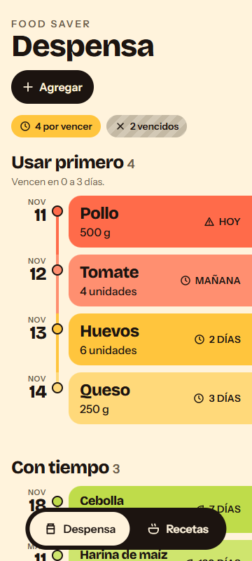

# Food Saver

Aplicación web para aprovechar los ingredientes antes de que venzan: registras lo que tienes en casa, la app te muestra una **línea de tiempo** que baja de lo más urgente a lo menos urgente (los vencidos van aparte) y te sugiere recetas que usan lo que está por vencer, indicando qué ingredientes te faltan.

Todo funciona en el navegador y los datos se guardan en `localStorage` (no hay servidor, login ni IA). Las fuentes están empaquetadas: la demo no necesita internet.



## Instalar y ejecutar (3 pasos)

```bash
npm install      # 1. instala dependencias
npm run dev      # 2. arranca en http://localhost:5173
npm test         # 3. (opcional) corre las pruebas
```

Otros comandos: `npm run build` (compila para producción) y `npm run preview` (sirve la compilación).

Al abrir por primera vez se cargan **datos de ejemplo** con fechas relativas a hoy. Demo sugerida: en *Recetas*, "Huevos pericos" aprovecha el tomate (mañana) y los huevos (en 2 días); "Arroz con leche" queda en "No alcanza" porque la leche está vencida.

## Requisito → dónde está en la app

| Req. | Qué pide | Dónde está en la app | Código |
|---|---|---|---|
| **R1** | Agregar y actualizar ingredientes (nombre, cantidad, unidad, vencimiento) | Pestaña **Despensa**: botón **+ Agregar** (cabecera) abre una hoja inferior con el formulario. Al **tocar cualquier banda** de la línea de tiempo se abre la hoja de opciones con **Usé**, **Editar** y **Borrar** (con confirmación dentro de la hoja). Un nombre repetido se guarda como otro lote. "Usé" descuenta cantidad; si llega a 0 el lote se elimina. | `src/pages/Despensa.tsx`, `src/components/Hoja.tsx`, `FormularioIngrediente.tsx`, `OpcionesIngrediente.tsx`; `agregarValidado` / `editarValidado` / `usarIngrediente` en `src/domain/despensa.ts` |
| **R2** | Ordenar por fecha de vencimiento | Pestaña **Despensa**: línea de tiempo vertical en tres secciones, **Usar primero** (vence en 0 a 3 días), **Con tiempo** y **Ya vencieron · no entran en recetas**. Cada banda lleva su fecha, su color por urgencia, un ícono y el texto ("Hoy", "Mañana", "2 días"…). | `agruparPorUrgencia`, `nivelUrgencia`, `textoRelativoCorto` en `src/domain/formato.ts`; `ordenarPorVencimiento` en `despensa.ts`; `src/components/FilaTiempo.tsx` |
| **R3** | Rechazar cantidades inválidas con mensaje claro | Formularios **Agregar**, **Editar** y **Usé**: el error aparece en español debajo del campo (vacía, 0, negativa, texto, Infinity, mayor que 100000). Se acepta la coma decimal ("2,5"). En **Usé** tampoco deja descontar más de lo que hay. | `validarCantidad`, `validarIngrediente` en `src/domain/validacion.ts` |
| **R4** | Vencidos por separado y fuera de las sugerencias | Pestaña **Despensa**, sección **Ya vencieron · no entran en recetas** (gris rayado, nombre tachado, "Hace N días"). En **Recetas** un lote vencido nunca cuenta: la receta lo muestra como faltante ("Lo que tienes de leche está vencido…"). | `separarVencidos`, `esVencido` en `src/domain/`; `sugerirRecetas` en `src/domain/recetas.ts` |
| **R5** | Sugerir recetas con los ingredientes disponibles | Pestaña **Recetas**, sección **Puedes cocinar ahora** (bloques lima), primero las que más ingredientes por vencer aprovechan; **Aprovecha lo que vence** usa la misma línea de tiempo en pequeño. | `sugerirRecetas` en `src/domain/recetas.ts`, `src/pages/Recetas.tsx`, `src/components/BloqueReceta.tsx` |
| **R6** | Identificar los ingredientes faltantes | Pestaña **Recetas**, sección **No alcanza** (bloques gris rayado): **Qué te falta** lista cada faltante con cantidad y motivo (no tienes, no alcanza, vencido o unidad incompatible). | `Faltante` / `describirFaltante` en `src/domain/` |
| **R7** | Los datos persisten al recargar | Automático en cada cambio (agregar, editar, usé, borrar): se guarda en `localStorage`, clave `foodsaver:v1`. Si los datos están dañados la app avisa, carga los ejemplos y guarda una copia. Si borras todo, la despensa queda vacía con el botón **Cargar datos de ejemplo**. | `src/storage/almacen.ts`, `src/domain/persistencia.ts`, `src/hooks/useDespensa.ts` |
| **R8** | Colección de recetas predefinida | Pestaña **Recetas**: 12 recetas caseras colombianas; **Ver ingredientes y preparación** despliega ingredientes e instrucciones. | `src/data/recetas.ts` |

## Diseño

Especificación completa en [`DISENO.md`](DISENO.md): paleta "Fruta + línea de tiempo", tipografía (Bricolage Grotesque e Instrument Sans, empaquetadas con `@fontsource`), anatomía de la fila, movimiento y accesibilidad. Capturas en `docs/capturas/` (360 px y 1280 px).

## Pruebas

- `npm test`: pruebas de la lógica (`src/domain`), de los datos de ejemplo (`src/data`) y del almacenamiento (`src/storage`).
- Pruebas de navegador con la interfaz real y verificación del diseño: ver `VERIFICATION.md` (se instalan aparte, no son dependencias del proyecto).

## Estructura

```
src/domain/     lógica pura (fechas, unidades, validación, despensa, recetas, persistencia, formato) + tests
src/data/       seed.ts (ejemplo con fechas relativas) y recetas.ts
src/storage/    localStorage (clave foodsaver:v1) y reloj
src/hooks/      estado de la despensa, fecha de hoy y revelado al hacer scroll
src/pages/      Despensa y Recetas
src/components/ piezas de interfaz (línea de tiempo, hoja inferior, formularios, barra inferior)
scripts/        pruebas de navegador y capturas (Playwright, opcionales)
docs/capturas/  imágenes de la app a 360 px y 1280 px
```

Documentos del proceso: `CONTEXT.md`, `PLAN.md`, `VERIFICATION.md`, `DISENO.md`.
